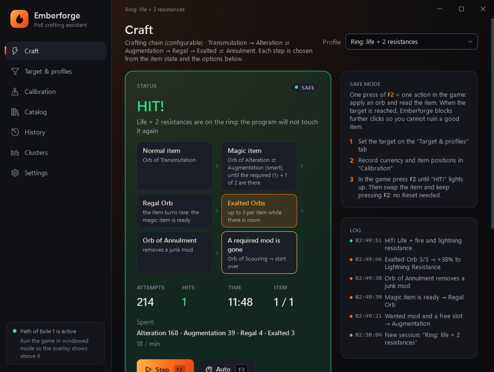
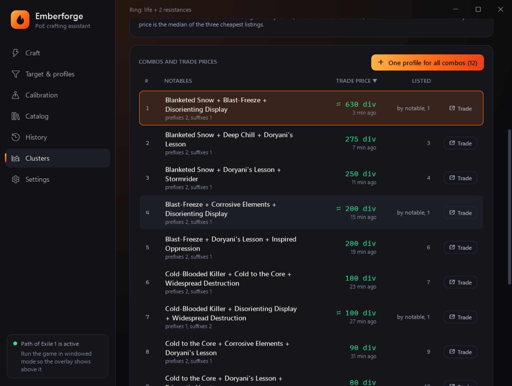

<a href="README.md">Русский</a> · <b>English</b>

  

<h1 align="center">Emberforge — free PoE autocraft and crafting helper for Path of Exile 1 and 2</h1>

  <b>A free Path of Exile crafting tool for PoE 1 and PoE 2</b>, in English and Russian: alteration and chaos spam, Regal and Exalted chains, essences, T17 map rolling, cluster jewel crafting with trade prices, 6 sockets and 6-link. 
  Craft faster without memorising mod texts and without fear of rerolling a good item.

  <a href="https://github.com/GStoneG/emberforge-releases/releases/latest/download/Emberforge-win-Setup.exe"><b>⬇ Download the installer</b></a>
  &nbsp;·&nbsp; Windows 10/11 · updates itself · <a href="https://github.com/GStoneG/emberforge-releases/releases/latest/download/Emberforge.exe">or a single file, no installation</a>

Main screen: the ring crafting chain reached its target, “HIT!”, the wanted mods are highlighted in green.

---

> ### 🛡️ Safe crafting, within the game rules
> In **safe mode** (on by default) Emberforge never presses anything by itself: **one key press from you is one action in the game**. That is exactly what Grinding Gear Games requires: “one key press, one server action”. The program does not read the game's memory, does not inject into the process and does not modify game files; it only helps you avoid mistakes and never ruin a good item.
>
> You craft faster without risking a ban for auto-clicking. Auto mode, which breaks the rules, is off and can only be enabled after explicitly accepting the risk.

## In short

- **PoE autocraft to your target:** set the mods, the program picks the next orb and stops on a hit.
- **Alteration, Augmentation, Regal, Chaos, Exalted, Annulment, Scouring**, essences and any custom currency.
- **Cluster jewel crafting:** trade prices of every notable combo and one profile for every profitable combo.
- **T17 map and Waystone rolling** by item quantity and forbidden mods.
- **6 sockets and 6-link:** Jeweller's Orb and Orb of Fusing.
- **PoE 2:** Sinistral and Dextral Omens, Essences instead of Regal.
- **Safe mode:** one key press, one action in the game, within GGG's rules.
- **Free**, English and Russian interface, English and Russian game client.

## Why you need it

Crafting in Path of Exile means hundreds of identical actions: pick up an orb, click the item, read the mods, decide what to do next. It is slow and tiring, and it is easy to make a mistake: one extra click and the mod you spent fifty orbs on is gone.

**Emberforge takes over the routine.** You describe once what you want, and on every step the program:

1. **reads the item** the same way you do, by copying its text (Ctrl+C);
2. **checks** whether the wanted result appeared;
3. **decides** which orb to use next and applies it when you press the key;
4. **stops by itself** as soon as the target is reached, and never touches the good item again.

## Features

### 🎯 Targets without memorising mods
Start typing “life”, “cold res” or “attack speed” right in the mod box, and Emberforge suggests the mods exactly as the game writes them. The database has **8,600+ PoE1 mods and 3,500+ PoE2 mods** with texts of both the English and the Russian client. Set the minimum value, whether the mod must be a prefix or a suffix and the required tier (T1, T2…). Mark mods “Required” and ask for any N of the rest: e.g. life required + any 2 of 5 resistances.

### 🗺️ Rolling T17 maps and Waystones
Set “Item Quantity ≥ 90%”, “More Currency”, “Pack Size” and a list of mods you never want (reflect, “players cannot regenerate”…). Emberforge chaoses the map until it is right. You can queue **several maps at once**: the program goes through them one by one.

### ⛓️ Real crafting chains
Not just spamming one orb, but a chain that thinks about every step:

> Transmutation → **Alteration ⇄ Augmentation** → **Regal Orb** → **Exalted ⇄ Annulment** → if the target is missed: Scouring or Chaos

- **Smart Augmentation:** looking for a suffix but Alteration only gave a prefix? Emberforge uses an Orb of Augmentation on the free slot instead of rerolling the item for nothing.
- **Regal Orb** when the magic item has the wanted mods and no junk.
- **Two lists: magic and rare item.** The “Magic item” list says what to roll before the Regal Orb: required mods plus “one of” the others (e.g. life + chaos **or** fire). The “Rare item” list is the finished item (e.g. life + any 2 of 5 resistances).
- **Reactions after the Regal Orb and Exalts:** wanted mod → go on, junk → Annulment, Scouring and restart, or stop (set separately for the Regal and for Exalts). You choose how many Exalted Orbs go into one item. If a required magic-item mod is lost, the chain starts over.
- **Chain diagram:** the stages are shown as blocks and the current one lights up while crafting.
- **Exalted Orb** while a missing mod can still land in a free slot; **Orb of Annulment** when a junk mod takes the space.
- **Limits** for every orb (e.g. “at most 5 Exalted”) so you never burn expensive currency.

Simple modes are there too: Chaos, Alteration, Essence or any other currency spam.

### 🛡️ Protection from mistakes
- **Lock on hit.** Once the target appears, no more clicks happen however often you press.
- **Check before every action.** If you crafted something by hand, the program notices and will not ruin the item.
- **Lag protection.** If the item did not change after an action, the program looks at the orb stack. Same count: the click did not go through, and the program repeats it on its own (at most 5 times in a row). One orb fewer: it waits longer for the game, and if the item is still the same, the orb simply rolled the same mods and crafting goes on. In “Hold Shift” mode the stack is not visible: the program waits for the game and takes an unchanged item for the same roll a few times in a row (more for sockets and links), then stops. Stop reasons are saved in the history (CSV). The first time an orb is used, the program checks that its cell holds that orb.
- **Wrong item.** If a different item is under the cursor, crafting stops.
- **Emergency stop** with one key, even in the middle of an action.

### 🔍 Check without spending currency
Copy an item in the game (Ctrl+C; Ctrl+Alt+C is needed only for a tier filter) and press “Check item from clipboard”: matching mods turn green, forbidden ones red. Handy for tuning a target before spending orbs.

### 💰 Cost and odds
Currency prices come from poe.ninja for the chosen league (chaos in PoE1, exalts in PoE2), so you see what a session and a single hit cost. “Odds” estimates the chance per attempt and the average cost from the game's mod weights. For now PoE1 only and only for the Chaos, Alteration and Alteration + Augmentation strategies: the PoE2 game data has no real mod weights. “Search on trade” opens the official trade site with the base and the wanted mods to estimate the price.

### 💠 What to craft on a cluster jewel

The “Clusters” page: choose the jewel (large, medium, small), the enchant, the passive count, the item level and the league. The program collects prices of every full notable combo (3 notables on a large cluster) from the official trade site, straight from your PC and within the site’s rate limits, and keeps them on disk with their check history. “Fill in missing prices” searches by each notable (one search prices many combos) and fills in the rest; “Refresh all data” re-checks everything at a gentle pace (one to three hours, on its own). The table sorts by any column and filters by a minimum selling price (e.g. from 1 Divine Orb), and “One profile for all combos” makes one “Crafting chain” profile for the whole list: the auto crafter stops on any of its combos. On the rare item the chain loops: a Regal without a wanted notable → Exalted Orb; an Exalted junk mod → Orb of Annulment; the Annulment took the junk → Exalted again, and if it took a magic-item notable → Orb of Scouring and start over. Every combo has a “Trade” button to check the price by hand.

Sockets and links (PoE1): the “Sockets and links (6-link)” strategy uses Jeweller's Orbs until the item has the sockets it needs, then Orbs of Fusing until enough of them are linked (e.g. 6 sockets and 6 links). The target says what to make: sockets only, links only (on the sockets the item has, no Jeweller's Orbs) or sockets then links, and how many. Unique items work too. 6 sockets exist only on body armours and two-handed weapons of item level 50+, which the program checks.

The program reads the game client language from the game log (`logs/Client.txt` next to the game) while the game window is active: new profiles and the cluster profile follow it. The log has no league, so prices use the current league or the one chosen in Settings.

### 🧩 Grid, history, sharing
To craft maps or rings in bulk, record two corner cells of the inventory or a stash tab and the program fills in every item position. History keeps each session (attempts, currency, cost and the items you got) and exports to CSV. A profile can be copied as one line and sent to a friend, and the program tells you on start when a new version is out.

### 🔮 PoE2: Omens and Essences
When the missing mods roll only as prefixes or only as suffixes, the chain suggests the matching Sinistral or Dextral Omen before an Exalted, Annulment, Regal or Chaos Orb. You activate it in the game and the program applies the orb on the next step (it never clicks Omens itself). An Essence can replace the Regal Orb.

### 🪟 Works above the game
A small translucent panel on the right of the game window shows the status, the number of attempts and hotkey hints. It does not catch the mouse and does not get in the way. Hotkeys work right inside the game.

The overlay can be dragged with the mouse (the pin button unpins and pins it), and its opacity changes with the “−”/“+” buttons on it. While the program clicks, the overlay lets clicks through, and it never takes focus from the game.

### 🌐 English and Russian interface
On first launch the program asks for the language; you can switch it in Settings at any time, no restart needed. The interface language is independent of the game: Russian and English clients of PoE1 and PoE2 are supported. Each profile stores its game client (Russian or English); switching it translates the conditions taken from the mod database automatically.

### 📚 Catalog
Official English and Russian names of orbs, essences, fossils, resonators, Delirium orbs and base items, searchable in both languages, copied with one click.

## How it works

Emberforge does what you would do by hand: it moves the mouse, presses keys and reads the item text from the clipboard. It **does not read the game's memory, does not inject into the process and does not modify game files.**

**Safe mode (default):** one key press from you is one action in the game. This follows Grinding Gear Games' rule “one key press, one server action”.

> ⚠️ There is also an **auto mode** where the program clicks by itself. It directly breaks GGG's rules and can get you banned, so it is off by default and can only be enabled after explicitly accepting the risk. Use Emberforge at your own risk.

## Quick start

1. **Download** the [installer](https://github.com/GStoneG/emberforge-releases/releases/latest/download/Emberforge-win-Setup.exe) and run it; choose English on the first screen. New versions install with the “Update” button inside the program (only the changes are downloaded). No installation: [Emberforge.exe](https://github.com/GStoneG/emberforge-releases/releases/latest/download/Emberforge.exe), a single file.
2. Switch Path of Exile to **“Windowed”** or **“Windowed fullscreen”**.
3. **Target & profiles:** pick a ready profile (e.g. “T17 map: item quantity 90%+”) or find the mods you want with the search.
4. **Calibration:** press “Record” next to each orb, hover its stack in the game and press `F4`. Orb positions are shared by all profiles, so you record them once. Record the place of the item the same way.
5. In the game press **`F2`** until **“HIT!”** lights up. Swap the item and keep pressing `F2`. Emergency stop: `F10`.

## FAQ

**Windows says “Windows protected your PC”.**
The program has no paid code-signing certificate. Click “More info” → “Run anyway”. The checksum of every release is next to it in `Emberforge.exe.sha256`.

**Key presses do not reach the game.**
If the game runs as administrator, run Emberforge as administrator too: Windows does not let normal programs control elevated windows.

**I cannot see the panel above the game.**
Use windowed or windowed fullscreen mode: in exclusive fullscreen Windows does not show windows above the game.

**Does it support the English game client?**
Yes, PoE1 and PoE2. Each profile stores its game client (Russian or English) on the “Target & profiles” page: mods from the database are added exactly as your client shows them. If a profile is written for the other client, the program stops and tells you what to change.

**How do I update?**
The program tells you on start when a new version is out. Download the file from the same link: it always points to the latest version. Profiles, history and settings are kept in `%AppData%\Emberforge`.

**Is Emberforge free?**
Yes. Download and use it for free, no sign-up and no subscription.

**Is it a bot? Can I get banned for autocrafting?**
In safe mode (the default) the program never presses anything by itself: one key press from you is one action in the game, as Grinding Gear Games requires. It does not read the game's memory or inject into the process. Auto mode, where the program clicks by itself, breaks the rules and can get you banned, so it is off and can only be enabled after explicitly accepting the risk.

**Does it support Path of Exile 2?**
Yes: Waystone rolling, crafting chains, Essences, Sinistral / Dextral Omen hints, the PoE2 mod database.

**How do I craft a cluster jewel with the notables I want?**
On the “Clusters” page pick the jewel and the enchant: the program collects trade prices of every notable combo and makes one profile for every combo above your price. The crafting chain (Alteration → Regal → Exalted) then stops on any of them.

**How do I 6-link body armour?**
The “Sockets and links” strategy: Jeweller's Orbs up to 6 sockets, then Orbs of Fusing up to 6 links. You can also choose sockets only or links only.

## Emberforge, Advanced Stash Helper (ASH) and Path of Craft

Looking for a PoE autocraft tool and know Advanced Stash Helper (poeautocraft.com) or Path of Craft (pathofcraft.net)? The short difference, based on their websites as of November 2026:

| | Emberforge | Advanced Stash Helper (ASH) | Path of Craft |
|---|---|---|---|
| Price | free, every feature | free trial; full $8/month ($4/month billed yearly) | Basic free; Premium $7/month, $15/league or $90 lifetime |
| PoE 1 and PoE 2 | yes, one program | yes, one subscription | separate programs for PoE 1 and PoE 2 |
| “One key press, one action” mode | yes, on by default | — | — |
| Alteration, Augmentation, Chaos, essences | yes | yes (trial) | yes (Basic) |
| Rare items: Regal, Exalted, Annulment | yes, with junk-mod reactions | Exalted and Annulment paid | Premium |
| T17 map rolling | yes | map crafting in the trial; T16.5 and T17 paid | map crafting in Premium |
| Cluster jewels | trade prices of every combo + one profile for all | combos (comb craft) paid | cluster price search in Premium |
| Sockets and links (6-link) | yes | yes (trial) | yes (Basic) |
| Harvest, fossils | fossils as custom currency; no Harvest | paid | Basic |
| Russian interface | yes | yes | — |

Emberforge is not affiliated with Advanced Stash Helper or Path of Craft; names belong to their owners. If something here is out of date, tell us and we will fix it.

---

Source code is closed. Emberforge is an independent project, not affiliated with Grinding Gear Games.

Keywords: PoE autocraft, Path of Exile autocraft, PoE crafting tool, Path of Exile crafting helper, PoE 2 crafting, cluster jewel crafting, PoE 6 link, alteration spam, chaos spam, T17 map rolling, essence crafting, PoE craft bot, automated crafting tool for Path of Exile, Advanced Stash Helper alternative, ASH alternative, Path of Craft alternative.
