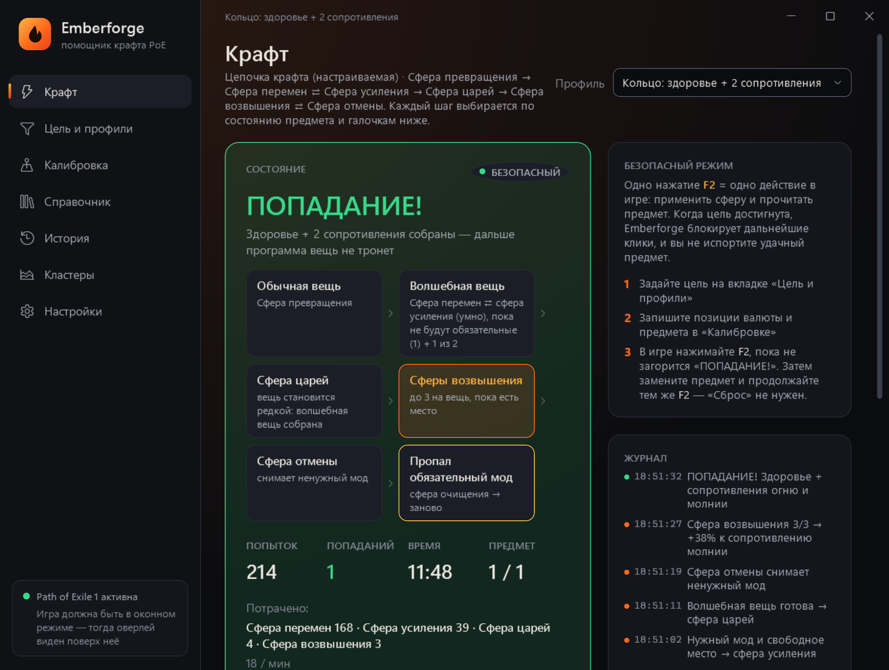
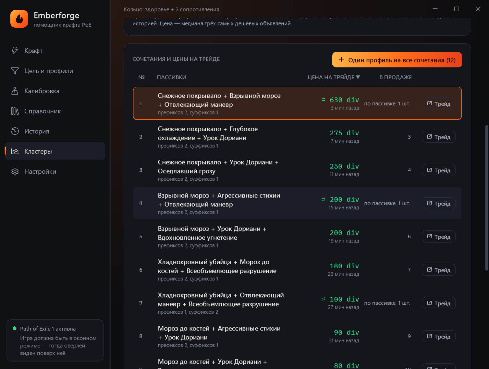

<b>Русский</b> · <a href="README.en.md">English</a>

  

<h1 align="center">Emberforge — автокрафт и помощник крафта для Path of Exile 1 и 2</h1>

  <b>Бесплатная программа для крафта в PoE 1 и PoE 2</b> на русском языке: спам сферой перемен и хаоса, цепочки со сферой царей и возвышения ⇄ отмены, эссенции, роллинг карт T17, крафт кластерных самоцветов с ценами трейда, 6 гнёзд и 6-линк, спам сферой удачи и древней сферой до нужного уникального. 
  Крафтите быстрее, не держа в голове тексты модов и не боясь «перекрафтить» удачную вещь.

  <a href="https://github.com/GStoneG/emberforge-releases/releases/latest/download/Emberforge-win-Setup.exe"><b>⬇ Скачать установщик</b></a>
  &nbsp;·&nbsp; Windows 10/11 · обновляется сама · <a href="https://github.com/GStoneG/emberforge-releases/releases/latest/download/Emberforge.exe">или один файл без установки</a>

Главный экран: цепочка крафта кольца дошла до цели — «ПОПАДАНИЕ!», нужные моды подсвечены зелёным.

---

> ### 🛡️ Безопасный крафт — по правилам игры
> В **безопасном режиме** (включён по умолчанию) Emberforge ничего не нажимает сам: **одно ваше нажатие — одно действие в игре**. Ровно этого требует Grinding Gear Games: «одно нажатие — одно действие на сервере». Программа не читает память игры, не внедряется в процесс и не меняет её файлы, а только помогает вам не ошибиться и не испортить удачную вещь.
>
> Так вы крафтите быстрее и при этом не рискуете баном за автокликер. Авто-режим, который правила нарушает, выключен и включается только после явного согласия с риском.

## Коротко

- **Автокрафт PoE по вашей цели:** задали моды — программа сама решает, какую сферу применить, и останавливается на попадании.
- **Сферы перемен, усиления, царей, хаоса, возвышения, отмены, очищения**, сущности и любая своя валюта.
- **Цикл «возвышение ⇄ отмена»** для редких вещей и кластеров: сфера царей → сфера возвышения → сфера отмены → снова возвышение, пока не соберётся нужное; пропал мод волшебной вещи — очищение и заново.
- **Уникальные предметы:** спам сферой удачи по одной базе до нужного уникального и спам древней сферой до уникального с нужным названием. База из 1 200+ уникальных предметов с подсказками при вводе.
- **Крафт кластеров (cluster jewels):** цены всех сочетаний пассивок с официального трейда и один профиль на все выгодные сочетания.
- **Роллинг карт T17 и путевых камней** по количеству предметов и запрещённым модам.
- **6 гнёзд и 6-линк:** Сфера златокузнеца и Сфера соединения.
- **PoE 2:** предзнаменования левши и правши, сущности вместо сферы царей.
- **Безопасный режим:** одно нажатие — одно действие в игре, по правилам GGG.
- **Любые клавиши:** шаг, авто, запись и стоп — на любую клавишу, сочетание с Ctrl/Alt/Shift или боковую кнопку мыши.
- **Бесплатно**, на русском и английском, для русского и английского клиента игры.

## Зачем это нужно

Крафт в Path of Exile — это сотни одинаковых действий: взять сферу, кликнуть по вещи, прочитать моды, решить, что дальше. Это долго и утомительно, а главное — легко ошибиться: одно лишнее нажатие, и мод, ради которого вы потратили полсотни сфер, исчез.

**Emberforge берёт рутину на себя.** Вы один раз описываете, что хотите получить, а программа на каждом шаге:

1. **читает предмет** так же, как вы, через копирование текста (Ctrl+C);
2. **проверяет**, выпало ли нужное;
3. **решает**, какую сферу применить следующей, и применяет её по вашему нажатию;
4. **останавливается сама**, как только цель достигнута: удачную вещь программа больше не тронет.

## Что умеет

### 🎯 Цель — без зубрёжки модов
Начните вводить «здоровья», «сопр холод» или «скорость атаки» прямо в поле мода, и Emberforge подскажет моды в точности так, как они написаны в игре. В базе **8 600+ модов PoE1 и 3 500+ модов PoE2** с текстами русского и английского клиентов. Так же с подсказками вводятся **база предмета** (2 600+ баз снаряжения, флаконов и самоцветов PoE1 и PoE2: можно искать по названию или по классу, например «перчатки») и **уникальный предмет** (1 200+ уникальных PoE1). В редакторе видны только те поля, которые нужны выбранной стратегии. Укажите минимальное значение, должен ли мод быть префиксом или суффиксом и нужный тир (T1, T2…). Моды можно отметить «Обязательно», а из остальных потребовать любые N: например, здоровье обязательно + любые 2 из 5 сопротивлений.

### 🗺️ Роллинг карт T17 и путевых камней
Задайте «Количество предметов ≥ 90%», «Больше валюты», «Размер групп» и список модов, которые нельзя (отражение, «игроки не могут регенерировать»…). Emberforge кидает сферы хаоса, пока карта не станет такой, как нужно. Можно поставить в очередь **сразу несколько карт**: программа пройдёт их по очереди.

### ⛓️ Полноценные цепочки крафта
Не просто «спам одной сферой», а цепочка, которая думает над каждым шагом:

> Сфера превращения → **Сфера перемен ⇄ Сфера усиления** → **Сфера царей** → **Сфера возвышения ⇄ Сфера отмены** → если цель не собралась: сфера очищения или сфера хаоса

- **Умная сфера усиления:** ищете суффикс, а сфера перемен дала только префикс? Emberforge кинет сферу усиления на свободное место, а не будет перекидывать вещь впустую.
- **Сфера царей,** когда на волшебной вещи собраны нужные моды и нет лишних.
- **Два списка: волшебная и редкая вещь.** В списке «Волшебная вещь» задайте, что собрать до сферы царей: обязательные моды и «один из» остальных (например, здоровье + хаос **или** огонь). В списке «Редкая вещь» — каким должен быть готовый предмет (например, здоровье + любые 2 из 5 сопротивлений).
- **Реакции после сферы царей и возвышения:** нужный мод — идём дальше, ненужный — сфера отмены, сфера очищения и заново или остановка (настраивается отдельно для сферы царей и для сферы возвышения). Число сфер возвышения на одну вещь задаёте сами. Если пропал мод волшебной вещи, цепочка начнётся заново.
- **Цикл «возвышение ⇄ отмена» одной кнопкой** («Схема: сфера царей → возвышение ⇄ отмена»): ненужный мод после сферы возвышения снимается сферой отмены; отмена сняла ненужный — снова возвышение; ненужный мод всё ещё занимает место нужного — ещё одна отмена; сняла мод волшебной вещи — очищение и заново. После сферы царей можно выбрать: возвышение только если нужному моду есть место или «возвышение, потом отмена» даже без места.
- **Схема цепочки:** этапы показаны блоками, а во время крафта подсвечивается текущий.
- **Сфера возвышения,** пока недостающий мод может встать в свободное место; **сфера отмены,** когда лишний мод занимает место.
- **Лимиты** на каждую сферу (например, «не больше 5 сфер возвышения»), чтобы не слить дорогую валюту.

Простые режимы тоже есть: спам сферой хаоса, сферой перемен, сущностью или любой другой валютой.

### 💎 Уникальные предметы: сфера удачи и древняя сфера
- **Спам сферой удачи:** программа бьёт одну базу — сфера удачи, не вышло, сфера очищения, снова удача — пока не выпадет уникальный (любой или с нужным названием), и только потом переходит к следующей базе из сетки.
- **Спам древней сферой:** перековывает уникальный предмет в другой уникальный того же класса, пока не выпадет нужный по названию. Название можно писать по-русски или по-английски — подходит любое.

### 🛡️ Защита от ошибок
- **Блокировка на попадании.** Нужное выпало, и дальше кликов не будет, сколько ни нажимайте.
- **Проверка перед каждым действием.** Если вы скрафтили что-то руками, программа это увидит и не испортит вещь.
- **Защита от лага.** Если после действия предмет не изменился, программа смотрит на стопку сферы. Сфер столько же — клик не прошёл, программа повторит его сама (не больше 5 раз подряд). Сфера потрачена — подождёт ответа игры дольше, а если предмет тот же, значит выпало то же самое, и крафт продолжится. В режиме «Удерживать Shift» стопку не видно: там программа ждёт ответа игры и считает неизменный предмет «тем же самым» несколько раз подряд (у гнёзд и связей — больше), потом останавливается. Причины остановок попадают в историю (CSV). При первом использовании сферы программа проверяет, что в её ячейке лежит именно эта сфера.
- **Не тот предмет.** Если под курсором оказалась другая вещь, крафт остановится.
- **Экстренный стоп** одной клавишей, в том числе посреди действия.

### 🔍 Проверка без траты валюты
Скопируйте вещь в игре (Ctrl+C; Ctrl+Alt+C нужен только для фильтра по тиру) и нажмите «Проверить предмет из буфера»: зелёным подсвечены подходящие моды, красным запрещённые. Удобно, чтобы настроить цель до того, как тратить сферы.

### 💰 Стоимость и шансы
Цены валюты подтягиваются с poe.ninja для выбранной лиги (PoE1 — в сферах хаоса, PoE2 — в сферах возвышения). Программа показывает, во что обошлась сессия и одно попадание. Кнопка «Шансы» оценивает вероятность попадания за одну попытку и среднюю стоимость по весам модов из данных игры. Пока только для PoE1 и стратегий «Спам сферой хаоса», «Спам сферой перемен» и «Сфера перемен + сфера усиления»: настоящих весов модов PoE2 в данных игры нет. Кнопка «Найти на трейде» открывает официальный трейд с базой и нужными модами, чтобы прикинуть цену.

### 💠 Что крафтить на кластерном самоцвете

Страница «Кластеры»: выберите самоцвет (большой, средний, малый), зачарование, число пассивок, уровень предмета и лигу. Программа соберёт цены всех полных сочетаний пассивок (у большого кластера — 3 пассивки) с официального трейда, прямо с вашего компьютера и с соблюдением лимитов сайта, и сохранит их на диск с историей проверок. «Обновить недостающие цены» ищет по каждой пассивке (один поиск даёт цены многих сочетаний) и добирает остальное; «Обновить все данные» перепроверяет всё в бережном темпе (час-три, сам). Таблицу можно сортировать по любой колонке и фильтровать по минимальной цене продажи (например, от 1 божественной сферы), а кнопка «Один профиль на все сочетания» делает один профиль на стратегии «Цепочка крафта» для всего списка: автокрафтер остановится на любом сочетании из него. На редкой вещи цепочка идёт по кругу: после сферы царей без нужной пассивки — сфера возвышения; если возвышение дало ненужный мод — сфера отмены; отмена сняла ненужный мод — снова сфера возвышения, а если сняла пассивку волшебной вещи — сфера очищения и заново. У каждого сочетания есть кнопка «Трейд» для ручной проверки цены.

Гнёзда и связи (PoE1): стратегия «Гнёзда и связи (6-линк)» бросает Сферу златокузнеца, пока у вещи меньше нужного числа гнёзд, потом Сферу соединения, пока не будет нужного числа связанных (например, 6 гнёзд и 6 связей). В цели выбирается, что сделать: только гнёзда, только связи (на гнёздах, что уже есть, без Сфер златокузнеца) или гнёзда, потом связи, и сколько. Подходят и уникальные вещи. Сфера удачи: стратегия «Спам сферой удачи» долбит одну базу (очищение, удача) до уникального предмета — любого или с названием, которое вы указали, — и только потом переходит к следующей базе. Древняя сфера: стратегия «Спам древней сферой» перековывает уникальный предмет, пока не выпадет уникальный с нужным названием. 6 гнёзд бывают только у нательных доспехов и двуручного оружия с уровнем предмета 50+, программа это проверяет.

Язык клиента игры программа определяет сама по журналу игры (`logs/Client.txt` рядом с игрой), когда окно игры активно: под него создаются новые профили и профиль кластеров. Лиги в журнале нет, поэтому цены берутся для текущей лиги или той, что выбрана в «Настройках».

### 🧩 Сетка, история, обмен профилями
Чтобы крафтить карты или кольца пачкой, запишите две угловые ячейки инвентаря или вкладки — программа заполнит позиции всех предметов. История сохраняет каждую сессию: попытки, валюту, стоимость и полученные вещи; её можно выгрузить в CSV. Профиль можно скопировать одной строкой и отправить другу, а при запуске программа подскажет, если вышла новая версия.

### 🔮 PoE2: предзнаменования и сущности
Если недостающие моды бывают только префиксами или только суффиксами, цепочка подскажет нужное предзнаменование левши или правши перед сферой возвышения, отмены, царей или хаоса. Вы активируете его в игре, а программа применяет сферу следующим шагом (сама она по предзнаменованиям не кликает). Вместо сферы царей можно использовать сущность.

### 🪟 Работает поверх игры
Небольшая полупрозрачная плашка справа в окне игры показывает статус, число попыток и подсказки по клавишам. Она не перехватывает мышь и не мешает играть. Горячие клавиши работают прямо в игре.

Оверлей можно поставить в угол окна игры или перетащить мышью **в любое место экрана**, даже на второй монитор (кнопка с булавкой открепляет и закрепляет его), а прозрачность меняется кнопками «−»/«+» прямо на нём. Пока программа кликает, оверлей пропускает клики насквозь и никогда не забирает фокус у игры.

### ⌨️ Любые горячие клавиши и кнопки мыши
В «Настройках» нажмите на поле действия и затем нужную клавишу: любую, сочетание с Ctrl, Alt или Shift, колёсико или боковую кнопку мыши. Например, шаг крафта на боковую кнопку мыши — удобно кликать, не отрываясь от игры. Нажатие этой кнопки игра не получает, а в других программах (браузер) она работает как обычно.

### 🌐 Интерфейс на русском и английском
При первом запуске программа предложит выбрать язык. Его можно сменить в настройках в любой момент, без перезапуска. Язык интерфейса не зависит от языка игры: поддерживаются русский и английский клиенты PoE1 и PoE2. Клиент игры (русский или английский) задаётся в каждом профиле. Если его сменить, условия из базы модов переведутся сами.

### 📚 Справочник на русском
Официальные русские названия сфер, сущностей, ископаемых, резонаторов, сфер Делириума и базовых предметов: поиск по-русски и по-английски, копирование одним кликом.

## Как это работает

Emberforge делает то же, что и вы руками: двигает мышь, нажимает клавиши и читает текст предмета из буфера обмена. Он **не читает память игры, не внедряется в процесс и не меняет файлы игры.**

**Безопасный режим (по умолчанию):** одно ваше нажатие клавиши — одно действие в игре. Это соответствует правилу Grinding Gear Games «одно нажатие — одно действие на сервере».

> ⚠️ Есть и **авто-режим**, где программа кликает сама. Он прямо нарушает правила GGG, и за это могут забанить. Поэтому он выключен по умолчанию и включается только после явного согласия с риском. Используйте Emberforge на свой страх и риск.

## Быстрый старт

1. **Скачайте** [установщик](https://github.com/GStoneG/emberforge-releases/releases/latest/download/Emberforge-win-Setup.exe) и запустите: программа установится и создаст ярлык. Новые версии ставятся кнопкой «Обновить» внутри программы (скачиваются только изменения). Без установки — [Emberforge.exe](https://github.com/GStoneG/emberforge-releases/releases/latest/download/Emberforge.exe), один файл.
2. Переключите Path of Exile в режим **«Оконный»** или **«Оконный без рамки»**.
3. **Цель и профили:** выберите готовый профиль (например, «T17 карта — количество 90%+») или найдите нужные моды через поиск.
4. **Калибровка:** нажмите «Записать» у каждой сферы, наведите курсор на её стопку в игре и нажмите `F4`. Позиции сфер общие для всех профилей — их записывают один раз. Так же запишите место, где лежит предмет.
5. В игре нажимайте **`F2`**, пока не загорится **«ПОПАДАНИЕ!»**. Замените предмет и продолжайте тем же `F2`. Экстренная остановка: `F10`.

## Частые вопросы

**Windows пишет «Windows защитил ваш компьютер».**
У программы нет платной цифровой подписи. Нажмите «Подробнее» → «Выполнить в любом случае». Контрольная сумма одиночного exe лежит рядом в файле `Emberforge.exe.sha256`.

**Нажатия не доходят до игры.**
Если игра запущена от имени администратора, запустите Emberforge тоже от администратора: Windows не даёт обычным программам управлять «админскими» окнами.

**Плашку не видно поверх игры.**
Нужен оконный режим или оконный без рамки: в эксклюзивном полноэкранном режиме Windows не показывает окна поверх игры.

**Есть английский интерфейс? А английский клиент игры?**
Да и да. Язык интерфейса выбирается при первом запуске и меняется в настройках. Язык клиента игры (русский или английский) выбирается в профиле, на странице «Цель и профили»: тексты модов из базы добавляются так, как их показывает ваш клиент. Если профиль написан для другого клиента, программа остановится и подскажет, что поменять. Поддерживаются PoE1 и PoE2.

**Как обновиться?**
Если программа установлена установщиком, нажмите «Обновить» внутри неё: скачаются только изменения, и программа перезапустится. Одиночный exe — скачайте по той же ссылке, она всегда ведёт на последнюю версию. Профили, история и настройки сохраняются в `%AppData%\Emberforge`.

**Emberforge бесплатный?**
Да. Скачать и пользоваться можно бесплатно, без регистрации и подписки.

**Это бот? За автокрафт банят?**
В безопасном режиме (по умолчанию) программа ничего не нажимает сама: одно ваше нажатие — одно действие в игре, как требует Grinding Gear Games. Она не читает память игры и не внедряется в процесс. Авто-режим, где программа кликает сама, нарушает правила и может привести к бану — поэтому он выключен и включается только после явного согласия с риском.

**Поддерживается Path of Exile 2?**
Да: роллинг путевых камней, цепочки крафта, сущности, подсказки предзнаменований левши и правши, база модов PoE2 с русскими названиями.

**Как скрафтить кластерный самоцвет (cluster jewel) с нужными пассивками?**
На странице «Кластеры» выберите самоцвет и зачарование — программа соберёт цены всех сочетаний пассивок с трейда и сделает один профиль на все сочетания дороже заданной цены. Дальше цепочка крафта (сфера перемен → сфера царей → сфера возвышения) остановится на любом из них.

**Как сделать 6 линков (6-линк) на доспехе?**
Стратегия «Гнёзда и связи»: сначала Сфера златокузнеца до 6 гнёзд, потом Сфера соединения до 6 связей. Можно выбрать только гнёзда или только связи.

**Можно поставить шаг на боковую кнопку мыши?**
Да. В «Настройках» нажмите на поле «Шаг» и затем боковую кнопку мыши (или колёсико, или любую клавишу с Ctrl/Alt/Shift). В игре эта кнопка будет делать шаг крафта, а в браузере и других программах — работать как обычно.

**Работает с русским клиентом игры?**
Да, это главная особенность Emberforge: тексты модов, баз и уникальных предметов есть для русского и английского клиентов, и программа сама определяет язык клиента по журналу игры.

**Как спамить сферой удачи или древней сферой до нужного уникального?**
Выберите стратегию «Спам сферой удачи» или «Спам древней сферой» и начните вводить название уникального — программа подскажет его из базы. Сфера удачи бьёт одну базу до уникального, древняя сфера перековывает уникальный, пока не выпадет нужный.

---

Исходный код закрыт. Emberforge — независимый проект, не связанный с Grinding Gear Games.

Ключевые слова: автокрафт poe, автокрафт path of exile, программа для крафта poe, помощник крафта poe, крафт poe 2, крафт кластеров poe, крафт кластерных самоцветов, 6 линк poe, спам сферой перемен, спам хаосами, роллинг карт t17, крафт эссенциями, бот для крафта poe, PoE autocraft, PoE crafting tool, automated crafting tool for Path of Exile.
